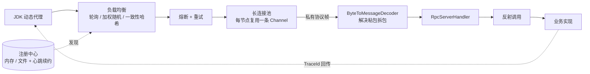
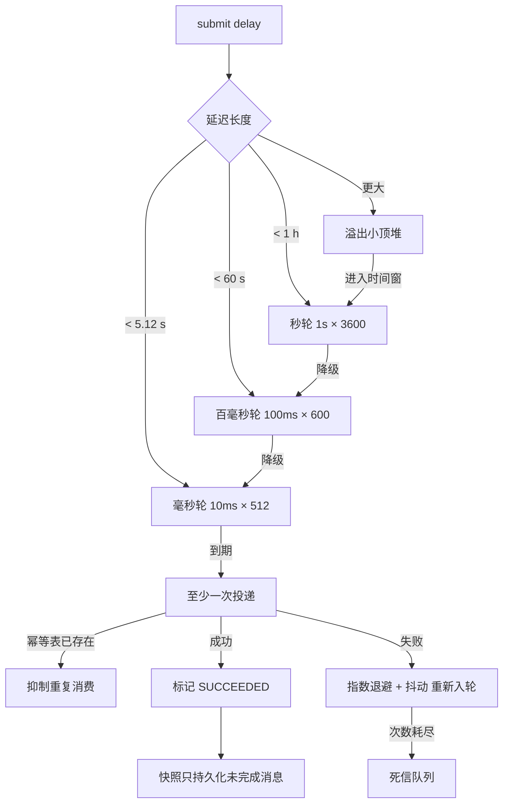

# backend-portfolio

两个面向后端面试的工程项目，重点不是 CRUD，而是**网络协议、并发调度与一致性**：

| 模块 | 一句话定位 | 最能被追问的难点 |
| --- | --- | --- |
| [`mini-rpc`](./mini-rpc/README.md) | 从零手写的 Netty RPC 框架 | 私有协议与粘包拆包、连接复用、超时重试、熔断、TraceId 透传 |
| [`delay-queue`](./delay-queue/README.md) | 分层时间轮延迟队列 | 至少一次投递、幂等消费、指数退避、死信、快照恢复、单调时钟抗回拨 |

技术栈：Java 17 + Maven，无 Spring、无 Redis、无 Kafka 等外部中间件依赖（RPC 模块仅依赖 Netty），`git clone` 后即可编译运行。

---

## 快速开始

```bash
# 全部测试（27 个用例）
mvn -B test

# RPC 单机 demo：真实起 Netty 服务端 + 客户端
mvn -q -pl mini-rpc org.codehaus.mojo:exec-maven-plugin:3.2.0:java \
  -Dexec.mainClass=dev.rainsolo.minirpc.demo.AllInOneDemo

# RPC 跨 JVM demo（两个终端分别运行）
mvn -q -pl mini-rpc org.codehaus.mojo:exec-maven-plugin:3.2.0:java \
  -Dexec.mainClass=dev.rainsolo.minirpc.demo.ProviderMain
mvn -q -pl mini-rpc org.codehaus.mojo:exec-maven-plugin:3.2.0:java \
  -Dexec.mainClass=dev.rainsolo.minirpc.demo.ConsumerMain

# 延迟队列端到端 demo（重试 / 死信 / 幂等 / 快照恢复）
java -cp delay-queue/target/classes dev.rainsolo.delayqueue.demo.DelayQueueDemo
```

压测程序：`dev.rainsolo.minirpc.demo.BenchmarkMain` 与 `dev.rainsolo.delayqueue.demo.DelayQueueBenchmark`。

---

## 项目一：mini-rpc



**协议帧**（固定头 22 字节，长度字段驱动半包判断）：

| 偏移 | 长度 | 字段 | 说明 |
| --- | --- | --- | --- |
| 0 | 2 | magic | `0xCAFE`，坏帧立即拒绝 |
| 2 | 1 | version | 协议版本 |
| 3 | 1 | type | REQUEST / RESPONSE / PING / PONG |
| 4 | 1 | status | OK / NOT_FOUND / SERVER_ERROR / TIMEOUT / CIRCUIT_OPEN |
| 6 | 8 | requestId | 请求-响应关联 |
| 14 | 4 | headerLen | TraceId / SpanId 等透传字段 |
| 18 | 4 | bodyLen | 上限 8 MiB，防恶意大包 |
| 22 | n | headers + body | 可插拔序列化（JDK SPI，默认 JDK 序列化） |

**关键实现取舍**

- 解码器先做**绝对读**（`getShort/getInt`）判断长度，不足时直接 return 且不移动 `readerIndex`，TCP 拆包才不会错位；配置了 8 MiB 帧上限。
- 每条远端节点只维护一条长连接，`ConcurrentHashMap` 复用；`IdleStateHandler` 驱动心跳 PING/PONG，服务端读空闲超时主动断连。
- 超时由 `CompletableFuture.get(timeout)` 控制，超时/网络异常标记 `retryable`，业务异常不重试；每次重试重新做服务发现，天然实现 failover。
- 熔断按 `serviceName@endpoint` 粒度，滑动窗口统计失败数，OPEN → HALF_OPEN 只放一个探测请求。
- 一致性哈希 160 个虚拟节点，扩缩容只重映射约 1/N 的 key（有单元测试验证）。

**本机压测**（JDK 17，Windows，16 线程 × 2000 次，预热 2000 次）

```
requests           : 32000
throughput         : 22289 req/s
failures           : 0
p50 / p95 / p99 ms : 0.69 / 1.30 / 1.58
```

---

## 项目二：delay-queue



**关键实现取舍**

- 三层时间轮按 delay 选层，高层 tick 到点时把任务**降级**重新计算，因此内存占用与消息数量无关、与层数有关；超过最高层进溢出堆，进入窗口后再入轮（有防止 poll/re-add 死循环的守护）。
- **所有 deadline 使用 `System.nanoTime()` 单调时钟**，wall clock 只用于展示创建时间；因此系统时间回拨不会造成重复投递或永久延迟（有单元测试注入可控时钟验证）。
- 快照保存的是**相对剩余毫秒数**而非绝对时间戳，恢复时用当前单调时钟重建 deadline，天然跨重启、跨时钟变更；`DELIVERING` 状态的消息恢复后重新投递，落实至少一次语义。
- 幂等表在投递前检查、成功后写入（生产可换 Redis SETNX 或数据库唯一索引）；重试采用指数退避 + equal jitter，避免重试风暴。

**本机压测**（10,000 条消息，延迟 10~199 ms）

```
dispatch throughput: 43656 msg/s
scheduling drift   : p50 11.58 ms, p95 18.10 ms, p99 19.49 ms
```

> 误差主要来自 10 ms 的 tick 粒度与批量到期时的投递排队——这正是可以主动讲清楚的取舍：把 tick 调到 1 ms 可降低延迟但会提高 CPU 占用。

---

## 测试

| 模块 | 用例数 | 覆盖点 |
| --- | --- | --- |
| mini-rpc | 18 | 编解码往返 / 粘包 / 逐字节拆包 / 坏帧与超大帧拒绝、注册表过期与跨实例、三种负载均衡、熔断状态机、重试策略、真实 Netty 调用、TraceId 透传、连接复用、超时、业务异常不重试 |
| delay-queue | 9 | 三层轮按时序投递、溢出堆、零延迟、重试后进死信、幂等去重、成功不重试、快照只存未完成、崩溃恢复重投、时钟回拨 |

```
mvn -B test   →   Tests run: 27, Failures: 0, Errors: 0
```

CI：`.github/workflows/ci.yml` 在 push / PR 时自动执行 JDK 17 构建与测试。

---

## 写进简历时怎么用

> **mini-rpc**：基于 Netty 设计私有二进制协议（magic + 长度字段 + 状态位），用绝对读解决 TCP 粘包拆包并限制单帧上限；实现长连接复用、心跳保活、请求级超时与可重试异常分类、按节点粒度的滑动窗口熔断、三种负载均衡及 TraceId 全链路透传。16 线程压测 32,000 次调用，吞吐 22,289 req/s，P99 1.58 ms，零失败。

> **delay-queue**：实现三层时间轮 + 溢出堆调度，支持最长小时级延迟；以单调时钟规避系统时间回拨，结合幂等表、指数退避与死信队列保证至少一次投递，快照按相对剩余时间持久化并支持崩溃恢复。10,000 条消息压测投递吞吐 43,656 msg/s，P99 调度误差 19.49 ms（受 10 ms tick 粒度约束）。

写的时候按「**场景规模 → 难点 → 方案与取舍 → 量化结果**」组织，并且准备好被问：为什么不用现成框架、某个参数是怎么定的、线上出过什么问题怎么复盘。

---

## 目录

```
backend-portfolio/
├── pom.xml                     # 聚合父工程
├── .github/workflows/ci.yml    # JDK 17 + mvn test
├── mini-rpc/                   # Netty RPC 框架
│   └── src/{main,test}/...
└── delay-queue/                # 分层时间轮延迟队列
    └── src/{main,test}/...
```

License: MIT
