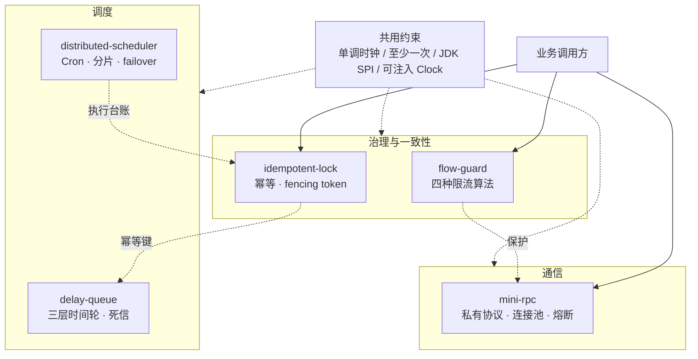

# backend-portfolio

一组用 Java 17 从零实现的后端基础设施组件，覆盖 **RPC 通信、延迟调度、流量治理、一致性与任务分片** 五个方向。

> **一句话**：把后端系统里容易被框架黑盒化的机制——TCP 私有协议、时间轮、限流算法、幂等与锁、Cron 分片调度——逐个拆开实现，并把设计取舍、边界条件与实测数据写清楚。

所有模块都是可独立构建、可单独依赖的库，运行时不依赖 Spring、Redis、Kafka 等外部中间件（仅 `mini-rpc` 依赖 Netty）。`git clone` 后 `mvn -B test` 即可完成全量构建与验证。

---

## 项目简介

现代后端开发大量依赖框架与中间件，关键机制往往被封装在依赖内部，出问题时很难定位。本项目把这些机制实现为最小可运行内核，用来回答一组具体问题：

- TCP 字节流如何界定消息边界，半包、粘包与坏帧分别怎么处理？
- 大量延迟任务如何低成本调度，进程重启后如何恢复？
- 限流算法在窗口边界与系统时钟回拨时分别会表现出什么行为？
- 锁过期之后，旧持有者的写入如何被下游识别并拦截？
- 定时任务在节点宕机、进程停机后如何补偿，且保证同一分片不被重复执行？

五个模块共享同一套工程约束：**纯 JDK 运行时**、**所有 deadline 基于单调时钟**、**至少一次语义配合幂等键**、**接口 / JDK SPI 留出可替换点**、**注入 `Clock` 以便确定性测试**。因此它们既能单独阅读，也能串成一条一致的技术主线。

## 特性

- **零外部中间件**：仅 `mini-rpc` 依赖 `netty-all`，其余四个模块运行时只依赖 JDK。
- **可独立构建**：`mvn -B -pl <模块> -am test` 单独验证任一模块，模块之间无编译期耦合。
- **确定性测试**：时间源统一抽象为 `Clock`，测试注入可变时钟，覆盖时钟回拨、快照恢复、闰年 Cron、并发竞态等边界条件。
- **可替换设计**：序列化、注册中心、限流算法工厂、幂等 / 锁存储均通过接口或 JDK `ServiceLoader` 暴露扩展点，生产环境可换成 Redis、ZooKeeper 等实现。
- **77 个 JUnit 5 用例**：含逐字节拆包、坏帧拒绝、真实 Netty 调用、并发幂等、GC 停顿脏写、worker 宕机 failover。
- **可复现的性能数据**：每个模块提供端到端 demo 与压测程序，README 记录实测吞吐与 p99，并标注测量条件与局限。

## 架构总览



## 模块介绍

| 模块 | 定位 | 核心能力 | 本机实测（JDK 17 / Windows） |
| --- | --- | --- | --- |
| [`mini-rpc`](./mini-rpc/README.md) | Netty RPC 框架 | 私有协议与粘包拆包、连接复用、超时重试、熔断、TraceId 透传 | 22,289 req/s，P99 1.58 ms，0 失败 |
| [`delay-queue`](./delay-queue/README.md) | 分层时间轮延迟队列 | 至少一次投递、幂等消费、指数退避、死信、快照恢复、抗时钟回拨 | 43,656 msg/s，P99 调度误差 19.49 ms |
| [`flow-guard`](./flow-guard/README.md) | 限流内核 | 固定 / 滑动窗口、漏桶、令牌桶、热点参数隔离、规则链、SPI 装配 | 336 万～645 万 ops/s |
| [`idempotent-lock`](./idempotent-lock/README.md) | 幂等执行器 + 分布式锁 | CAS 状态机、watchdog 续期、fencing token、锁超时释放 | 幂等 189 万 ops/s，锁 323 万 ops/s |
| [`distributed-scheduler`](./distributed-scheduler/README.md) | 分片定时任务调度 | 手写 Cron、一致性哈希分片、misfire 补偿、failover、幂等台账 | 11,729 triggers/s，分片分配 P99 0.29 ms |

### mini-rpc — 私有协议 RPC 框架

22 字节定长头（`magic` + `version` + `type` + `status` + `requestId` + `headerLen` + `bodyLen`）驱动半包判断，解码器用绝对读检查长度、不足时直接 return 且不移动 `readerIndex`，并限制单帧 8 MiB 防恶意大包。调用侧实现 JDK 动态代理、每节点一条长连接的连接池、`IdleStateHandler` 心跳保活、请求级超时与可重试异常分类、按 `serviceName@endpoint` 粒度的滑动窗口熔断，以及轮询 / 加权随机 / 一致性哈希三种负载均衡。序列化与注册中心都是可替换点。

**实测**：16 线程 × 2,000 次 = 32,000 次调用，吞吐 22,289 req/s，P50 / P95 / P99 为 0.69 / 1.30 / 1.58 ms，零失败。详见 [模块文档](./mini-rpc/README.md)。

### delay-queue — 分层时间轮延迟队列

三层时间轮按延迟长度选层，高层 tick 到点时把任务**降级**重新计算，内存占用与消息数量无关、只与层数有关；超出最高层的任务进溢出小顶堆，进入时间窗后再入轮。所有 deadline 使用 `System.nanoTime()`，wall clock 只用于展示创建时间，系统时间回拨不会造成重复投递或永久延迟。投递采用至少一次语义 + 幂等表 + 指数退避（equal jitter）+ 死信队列；快照保存**相对剩余毫秒数**而非绝对时间戳，恢复时用当前单调时钟重建 deadline，天然跨重启与时钟变更。

**实测**：10,000 条消息（延迟 10～199 ms），投递吞吐 43,656 msg/s，调度误差 P50 11.58 ms / P95 18.10 ms / P99 19.49 ms。误差主要来自 10 ms tick 粒度与批量到期排队——把 tick 调到 1 ms 可降低延迟但提高 CPU 占用，这是一个显式的取舍。详见 [模块文档](./delay-queue/README.md)。

### flow-guard — 四种算法限流内核

固定窗口、滑动窗口、漏桶、令牌桶四种实现，外加按 key 独立配额的 `HotKeyLimiter`（`LinkedHashMap` LRU 淘汰）与多规则 AND 组合的 `RuleChain`，算法通过 JDK `ServiceLoader` 按名装配。滑动窗口用环形小格把内存从 `O(QPS × 窗口)` 压到固定 `O(slots)`，代价是精度受 `windowMillis/slidingSlots` 约束（默认 100 ms）；令牌补充基于单调 `nanoTime` 且差值取非负，NTP 校时或时钟回拨不会凭空铸造令牌；冷启动 warmup 用分段梯形积分计算补充速率，避免拿瞬时速率乘整段时间造成前期超发。

**实测**：16 线程 × 10,000 次 = 160,000 次 `tryAcquire`，四种算法吞吐 336 万～645 万 ops/s、p99 2.5～104 us。demo 复现了固定窗口在交界处短时放出 `2×permits` 的临界突刺（`fixed AAAAAR|AAAAAR allowed=10` vs `sliding AAAAAR|RRRRRR allowed=5`）。注意四种实现都用 `synchronized` 换取并发配额精确，p99 主要反映抢锁与 JIT/GC 抖动，**不是算法优劣判据**。详见 [模块文档](./flow-guard/README.md)。

### idempotent-lock — 幂等执行器与分布式锁

幂等侧用 CAS 抢占状态机（`PROCESSING → SUCCEEDED / FAILED`）保证并发同 key 的 action 只执行一次，`CompletableFuture` 让并发调用复用同一结果；占位租约取 `ttl + waitTimeout`，避免慢执行者未完成就被第二个线程重新抢占。锁侧实现可重入、lease、watchdog 每 `lease/3` 续期、超时自动释放，以及每次成功抢占都严格递增的 **fencing token**——下游 `FencingTokenGuard` 只接受更大的 token，从而拦截 GC 停顿后旧持有者的脏写。所有 lease 判定只用 `nanoTime`，墙钟回拨不影响。存储层通过 SPI 可替换为 Redis `SETNX` + Lua。

项目**刻意不实现 Redlock**：多节点多数派仍依赖时钟漂移可忽略、网络延迟有界、进程无长停顿等假设，且不带 fencing token，无法识别过期后的旧写。README 有专节说明该决策。

**实测**：32 线程并发同 key 的 action 执行次数为 1；demo 复现 `T1 token=1` 停顿 → `T2 token=2` 写入成功 → `REJECTED stale token=1`；16 线程压测幂等 189 万 ops/s（p99 10.8 us）、锁 acquire/release 323 万 ops/s（p99 8.3 us）。该数字为单 JVM 内存实现，跨进程换 Redis 后数量级不同。详见 [模块文档](./idempotent-lock/README.md)。

### distributed-scheduler — 分片广播定时任务调度

手写 5/6 段 Cron 解析器（位集 + 逐字段进位），对 `0 0 29 2 ?` 这类稀疏表达式按"月不匹配跳下月 1 日、日不匹配跳次日 0 点"逐字段跳跃而非每秒暴力扫描，配合迭代上限与 8 年搜索上界，正确处理闰年 2/29 与跨年。调度链路为：触发检测 → 一致性哈希分片（160 虚拟节点）→ 存活 worker 分配 → 幂等台账去重 → `JobListener` 执行。misfire 只补最近一次并推进 `lastFire`，幂等键为 `jobName#fireTimeMillis#shardItem`；worker 心跳超时后分片由存活者重分配，已成功的分片被抑制、真正丢失的被补投，属"至少一次"语义。

开发中修正过一个真实缺陷：初版 FNV-1a 哈希分布偏斜导致 3→4 worker 时 200/300 分片重映射，加入 Murmur avalanche 混合后降到约 1/4。

**实测**：20 job × 200 触发 × 8 分片 = 32,000 次分片执行，吞吐 11,729 triggers/s，纯分片分配 p99 0.29 ms（`tick` p99 7.08 ms 含 listener 同步执行，不代表调度器自身开销）。详见 [模块文档](./distributed-scheduler/README.md)。

---

## 快速开始

**环境**：JDK 17+、Maven 3.8+。无需安装或启动任何中间件。

```bash
git clone https://github.com/RAINSOLO-MAX/backend-portfolio.git
cd backend-portfolio

# 全量构建与测试（77 个用例）
mvn -B test

# 只构建某个模块
mvn -B -pl flow-guard -am test
```

各模块的端到端 demo（先执行 `mvn -B test` 生成 `target/classes`）：

| 模块 | 命令 | 演示内容 |
| --- | --- | --- |
| mini-rpc | `mvn -q -pl mini-rpc org.codehaus.mojo:exec-maven-plugin:3.2.0:java -Dexec.mainClass=dev.rainsolo.minirpc.demo.AllInOneDemo` | 真实起 Netty 服务端 + 客户端完成调用 |
| mini-rpc | `...ProviderMain` / `...ConsumerMain`（两个终端） | 跨 JVM 服务发现与调用 |
| delay-queue | `java -cp delay-queue/target/classes dev.rainsolo.delayqueue.demo.DelayQueueDemo` | 重试 / 死信 / 幂等 / 快照恢复 |
| flow-guard | `java -cp flow-guard/target/classes dev.rainsolo.flowguard.demo.FlowGuardDemo` | 四种算法在窗口边界的放行序列 |
| idempotent-lock | `java -cp idempotent-lock/target/classes dev.rainsolo.idemlock.demo.IdempotentLockDemo` | 重复回调只扣一次 / GC 停顿后旧 token 被拒 |
| distributed-scheduler | `java -cp distributed-scheduler/target/classes dev.rainsolo.scheduler.demo.SchedulerDemo` | 正常触发 → failover → 重启 misfire 补偿 |

压测程序：`BenchmarkMain`（mini-rpc）、`DelayQueueBenchmark`、`FlowGuardBenchmark`、`IdempotentLockBenchmark`、`SchedulerBenchmark`，均在各自模块的 `demo` 包内，可直接用同样的 `java -cp` 方式运行。

## 项目结构

```
backend-portfolio/
├── pom.xml                     # 聚合父工程，5 个 module，统一 JDK 17 / JUnit 5
├── .github/workflows/ci.yml    # push / PR 时执行 JDK 17 + mvn test
├── mini-rpc/                   # Netty RPC 框架（唯一外部依赖 netty-all）
├── delay-queue/                # 分层时间轮延迟队列
├── flow-guard/                 # 四种算法限流内核 + SPI
├── idempotent-lock/            # 幂等执行器 + fencing token 锁
└── distributed-scheduler/      # Cron / 分片 / misfire / failover
    └── src/{main,test}/...     # 每个模块均含 demo 与 Benchmark
```

## 测试

| 模块 | 用例数 | 主要覆盖点 |
| --- | --- | --- |
| mini-rpc | 18 | 编解码往返、逐字节拆包、坏帧与超大帧拒绝、注册表过期、三种负载均衡、熔断状态机、真实 Netty 调用、TraceId 透传、超时 |
| delay-queue | 9 | 三层轮按时序投递、溢出堆、重试后进死信、幂等去重、快照只存未完成、崩溃恢复重投、时钟回拨 |
| flow-guard | 16 | 窗口临界突刺对照、小格过期与并发配额精确、令牌桶突发上限与 warmup、回拨不铸令牌、漏桶恒定速率、RuleChain、LRU 隔离、SPI 装配 |
| idempotent-lock | 12 | 32 线程同 key 只执行一次、失败重试 / TTL 重执行、锁互斥与可重入、watchdog 续期、fencing token 拦截旧写、超时自动释放 |
| distributed-scheduler | 22 | Cron 步长 / 列表 / 月末 L / 闰年 / 跨年 / 非法表达式、分片重映射比例、停机 misfire、快照重载、failover、重复触发抑制 |

```
mvn -B test   →   Tests run: 77, Failures: 0, Errors: 0, Skipped: 0
```

CI：`.github/workflows/ci.yml` 在 push / PR 时自动执行 JDK 17 构建与全量测试。

## 设计原则

1. **时间统一用单调时钟**。所有 deadline、lease、令牌补充都基于 `nanoTime()`，墙钟只用于展示或 Cron 的日历计算；因此 NTP 校时与时钟回拨不会造成重复投递、超发或锁提前过期。
2. **至少一次 + 幂等，而不是宣称恰好一次**。投递、补偿与 failover 都按"至少一次"设计，通过幂等键或台账去重，并在文档中明确业务侧仍需幂等。
3. **扩展点显式化**。序列化、注册中心、限流算法、幂等 / 锁存储都通过接口或 JDK SPI 暴露，替换实现不需要改核心逻辑。
4. **核心与容器解耦**。全部模块保持纯 JDK，不引入 Spring 自动配置；接入 Spring 只需把纯 JDK 对象声明为 `@Bean`，各模块 README 末尾给出了示例与取舍理由。
5. **可确定性验证**。注入 `Clock` 让测试能推进或回拨时间，覆盖那些在真实环境里几年才出现一次的边界（闰年、跨年、时钟回拨、停机补偿）。
6. **性能数据标注测量条件**。所有压测都写明线程数、样本量、预热与已知干扰因素，不做无条件的"高性能"宣称。

## 已知边界与后续方向

- **单 JVM 实现**：注册中心、幂等表、锁存储、快照文件均为进程内版本，跨进程需通过 SPI 换成 Redis / 数据库 / 共识存储；接口已按"原子抢占、按 owner 比较并替换"的语义设计。
- **压测方法**：使用模块内手写循环而非 JMH，p99 含线程调度、JIT 与 GC 抖动，仅作量级参考，不宜用于算法横向排名。
- **执行模型**：调度器的 `JobListener` 为同步串行执行，生产环境需要线程池、分布式选主与可观测性指标导出。
- **后续方向**：Redis 存储适配层、JMH 基准、指标 / 链路追踪导出、故障注入与混沌演练、更多协议与序列化实现。

---

License: MIT
