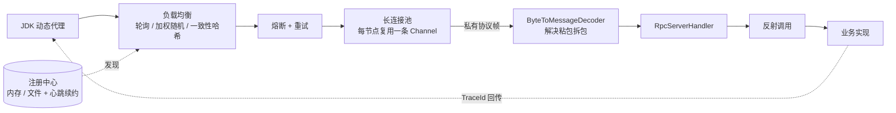
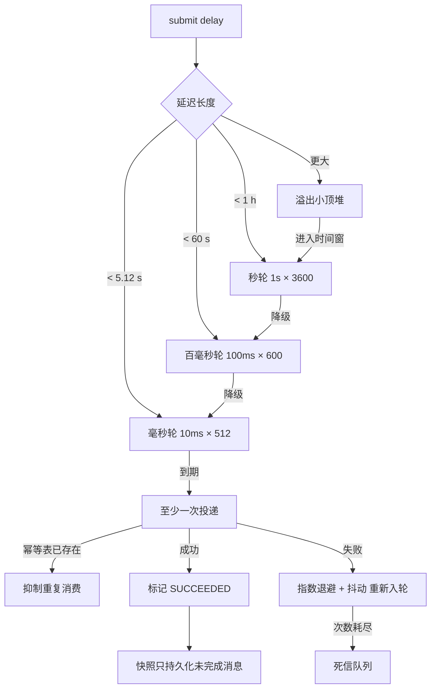
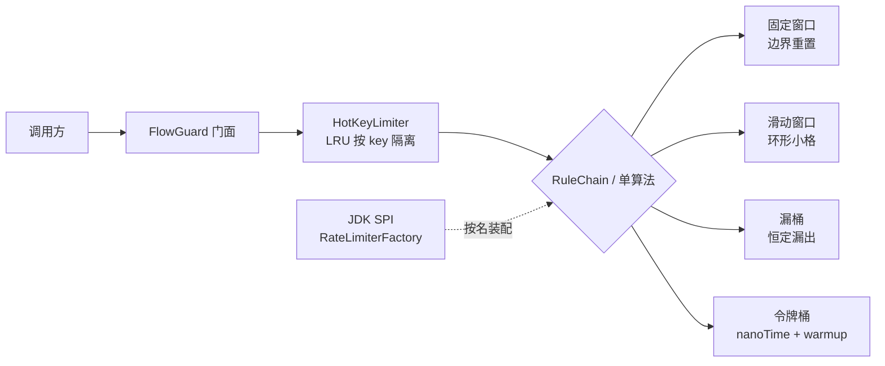
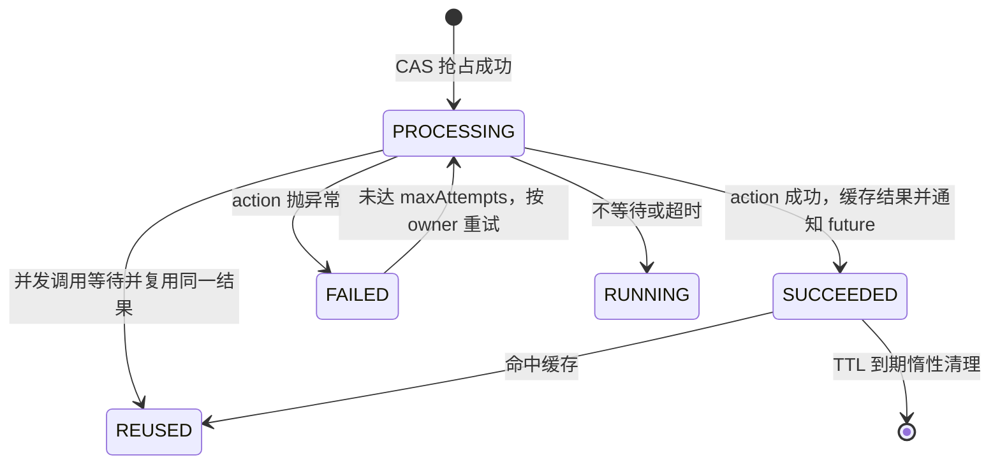
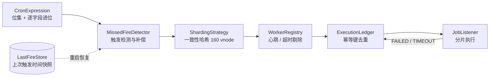

# backend-portfolio

五个面向后端面试的**造轮子**项目，重点不是 CRUD，而是**网络协议、并发调度与一致性**：

| 模块 | 一句话定位 | 最能被追问的难点 |
| --- | --- | --- |
| [`mini-rpc`](./mini-rpc/README.md) | 从零手写的 Netty RPC 框架 | 私有协议与粘包拆包、连接复用、超时重试、熔断、TraceId 透传 |
| [`delay-queue`](./delay-queue/README.md) | 分层时间轮延迟队列 | 至少一次投递、幂等消费、指数退避、死信、快照恢复、单调时钟抗回拨 |
| [`flow-guard`](./flow-guard/README.md) | 四种算法的限流内核 | 固定窗口临界突刺、滑动窗口精度换内存、令牌桶预热、单调时钟抗回拨 |
| [`idempotent-lock`](./idempotent-lock/README.md) | 幂等执行器 + 分布式锁 | CAS 抢占状态机、watchdog 续期、fencing token 防 GC 停顿脏写、为何不用 Redlock |
| [`distributed-scheduler`](./distributed-scheduler/README.md) | 分片广播定时任务调度 | 手写 Cron、一致性哈希分片、misfire 补偿、worker 宕机 failover、至少一次边界 |

技术栈：Java 17 + Maven，无 Spring、无 Redis、无 Kafka 等外部中间件依赖（RPC 模块仅依赖 Netty），`git clone` 后 `mvn test` 即可全量编译运行。五个模块刻意保持**纯 JDK + JDK SPI**，把算法与容器解耦——每个 README 末尾都给出了接入 Spring 的 `@Bean` 示例，以及"为什么没有做成 Starter"的取舍说明。

---

## 快速开始

```bash
# 全部测试（77 个用例，5 个模块）
mvn -B test

# RPC 单机 demo：真实起 Netty 服务端 + 客户端
mvn -q -pl mini-rpc org.codehaus.mojo:exec-maven-plugin:3.2.0:java \
  -Dexec.mainClass=dev.rainsolo.minirpc.demo.AllInOneDemo

# RPC 跨 JVM demo（两个终端分别运行）
mvn -q -pl mini-rpc org.codehaus.mojo:exec-maven-plugin:3.2.0:java \
  -Dexec.mainClass=dev.rainsolo.minirpc.demo.ProviderMain
mvn -q -pl mini-rpc org.codehaus.mojo:exec-maven-plugin:3.2.0:java \
  -Dexec.mainClass=dev.rainsolo.minirpc.demo.ConsumerMain

# 延迟队列端到端 demo（重试 / 死信 / 幂等 / 快照恢复）
java -cp delay-queue/target/classes dev.rainsolo.delayqueue.demo.DelayQueueDemo

# 限流：四种算法在同一窗口边界场景下的放行序列
java -cp flow-guard/target/classes dev.rainsolo.flowguard.demo.FlowGuardDemo

# 幂等 + 锁：重复支付回调只扣一次 / GC 停顿后旧 token 写入被拒
java -cp idempotent-lock/target/classes dev.rainsolo.idemlock.demo.IdempotentLockDemo

# 调度：正常触发 → worker 宕机 failover → 重启 misfire 补偿
java -cp distributed-scheduler/target/classes dev.rainsolo.scheduler.demo.SchedulerDemo
```

压测程序：`BenchmarkMain`（mini-rpc）、`DelayQueueBenchmark`、`FlowGuardBenchmark`、`IdempotentLockBenchmark`、`SchedulerBenchmark`。各模块可用 `mvn -B -pl <模块> -am test` 单独构建。

---

## 项目一：mini-rpc



**协议帧**（固定头 22 字节，长度字段驱动半包判断）：

| 偏移 | 长度 | 字段 | 说明 |
| --- | --- | --- | --- |
| 0 | 2 | magic | `0xCAFE`，坏帧立即拒绝 |
| 2 | 1 | version | 协议版本 |
| 3 | 1 | type | REQUEST / RESPONSE / PING / PONG |
| 4 | 1 | status | OK / NOT_FOUND / SERVER_ERROR / TIMEOUT / CIRCUIT_OPEN |
| 6 | 8 | requestId | 请求-响应关联 |
| 14 | 4 | headerLen | TraceId / SpanId 等透传字段 |
| 18 | 4 | bodyLen | 上限 8 MiB，防恶意大包 |
| 22 | n | headers + body | 可插拔序列化（JDK SPI，默认 JDK 序列化） |

**关键实现取舍**

- 解码器先做**绝对读**（`getShort/getInt`）判断长度，不足时直接 return 且不移动 `readerIndex`，TCP 拆包才不会错位；配置了 8 MiB 帧上限。
- 每条远端节点只维护一条长连接，`ConcurrentHashMap` 复用；`IdleStateHandler` 驱动心跳 PING/PONG，服务端读空闲超时主动断连。
- 超时由 `CompletableFuture.get(timeout)` 控制，超时/网络异常标记 `retryable`，业务异常不重试；每次重试重新做服务发现，天然实现 failover。
- 熔断按 `serviceName@endpoint` 粒度，滑动窗口统计失败数，OPEN → HALF_OPEN 只放一个探测请求。
- 一致性哈希 160 个虚拟节点，扩缩容只重映射约 1/N 的 key（有单元测试验证）。

**本机压测**（JDK 17，Windows，16 线程 × 2000 次，预热 2000 次）

```
requests           : 32000
throughput         : 22289 req/s
failures           : 0
p50 / p95 / p99 ms : 0.69 / 1.30 / 1.58
```

---

## 项目二：delay-queue



**关键实现取舍**

- 三层时间轮按 delay 选层，高层 tick 到点时把任务**降级**重新计算，因此内存占用与消息数量无关、与层数有关；超过最高层进溢出堆，进入窗口后再入轮（有防止 poll/re-add 死循环的守护）。
- **所有 deadline 使用 `System.nanoTime()` 单调时钟**，wall clock 只用于展示创建时间；因此系统时间回拨不会造成重复投递或永久延迟（有单元测试注入可控时钟验证）。
- 快照保存的是**相对剩余毫秒数**而非绝对时间戳，恢复时用当前单调时钟重建 deadline，天然跨重启、跨时钟变更；`DELIVERING` 状态的消息恢复后重新投递，落实至少一次语义。
- 幂等表在投递前检查、成功后写入（生产可换 Redis SETNX 或数据库唯一索引）；重试采用指数退避 + equal jitter，避免重试风暴。

**本机压测**（10,000 条消息，延迟 10~199 ms）

```
dispatch throughput: 43656 msg/s
scheduling drift   : p50 11.58 ms, p95 18.10 ms, p99 19.49 ms
```

> 误差主要来自 10 ms 的 tick 粒度与批量到期时的投递排队——这正是可以主动讲清楚的取舍：把 tick 调到 1 ms 可降低延迟但会提高 CPU 占用。

---

## 项目三：flow-guard（限流内核）



**关键实现取舍**

- 滑动窗口用**环形小格**而非逐请求时间戳：内存从 O(QPS × 窗口) 压到固定 O(slots)，代价是精度受 `windowMillis/slidingSlots` 约束（默认 100ms），`slots` 可调——显式的内存换精度。
- 令牌补充与等待全部基于单调 `nanoTime` 且差值取非负，NTP 校时 / 时钟回拨不会凭空铸造令牌；冷启动 warmup 用**分段梯形积分**算补充速率，避免拿瞬时速率乘整段时间造成前期超发。
- 四种算法本身是共享配额的最小内核，按 key 隔离交给 `HotKeyLimiter`（`LinkedHashMap` LRU，上限 `maxTrackedKeys`），组合交给 `RuleChain` 做 AND 并取最严 retryAfter。已知限制：拒绝时不回滚已放行规则的配额。

**本机压测**（16 线程 × 10,000 次 = 160,000 次 `tryAcquire`）

```
fixed    ops/s=6,453,825  p99=96.20 us
sliding  ops/s=3,365,799  p99= 2.50 us
leaky    ops/s=5,705,218  p99=96.80 us
token    ops/s=5,963,496  p99=104.40 us
```

> 四种实现都用 `synchronized` 保证并发下配额精确，p99 主要反映抢锁抖动，**不是算法优劣判据**。demo 里最值得看的是 `fixed AAAAAR|AAAAAR allowed=10` vs `sliding AAAAAR|RRRRRR allowed=5`——固定窗口在交界处短时放出 2× 配额的临界突刺，有单元测试用可变时钟复现。

---

## 项目四：idempotent-lock（幂等 + 分布式锁）



锁侧：`LockStore.acquire` 用 `ConcurrentHashMap.compute` 把"读旧值 → 判定过期 → 写入"收进一次原子操作，每次成功抢占由 `AtomicLong` 发出**严格递增的 fencing token**；watchdog 每 `lease/3` 续期，不续期则到点视为无主。

**关键实现取舍**

- 幂等占位租约取 `ttl + waitTimeout`，比结果缓存更长寿，防止 action 还没跑完就被第二个线程重新执行；`store.replace(key, expectedOwner, ...)` 避免 TTL 回收后的旧持有者覆盖新记录。
- **刻意不实现 Redlock**：多节点多数派仍依赖时钟漂移可忽略、进程无长停顿等假设，且不带 fencing token，GC 停顿后旧持有者的写无法被下游识别。改为"单存储原子抢占 + 下游 `FencingTokenGuard` 校验严格递增 token"，把过期后旧写的隔离放在资源侧。所有 lease 只用 `nanoTime`，墙钟回拨不影响。
- 存储层通过 JDK SPI 可替换为 Redis `SETNX` + Lua；接口按"原子抢占 / 按 owner 比较并替换"语义设计，映射到一个 Lua 脚本即可。

**本机压测**（16 线程 × 20,000 次 = 320,000 次操作，单 JVM 内存实现）

```
IDEMPOTENT_EXECUTE   1,889,164 ops/s   p99 10.8 us
LOCK_ACQUIRE_RELEASE 3,231,448 ops/s   p99  8.3 us
```

demo 场景 B 复现脏写拦截：`T1 token=1` → STW 停顿 → `T2 token=2 writeAccepted=true` → `REJECTED stale token=1`。

---

## 项目五：distributed-scheduler（分片调度）



**关键实现取舍**

- 不引 Quartz，手写 5/6 段 Cron 解析器以控制字段进位与异常语义；对 `0 0 29 2 ?` 这类稀疏表达式按"月不匹配跳下月 1 日、日不匹配跳次日 0 点"逐字段跳跃，而非每秒暴力扫描，配合 8 年搜索上界，正确处理闰年与跨年。
- misfire **只补最近一次**并推进 `lastFire`，幂等键为 `jobName#fireTimeMillis#shardItem`，避免补偿与历史成功记录冲突；failover 属"至少一次"而非"恰好一次"，明确要求 listener 业务幂等。
- 一致性哈希初版用 FNV-1a 分布偏斜，3→4 worker 时 200/300 分片重映射；加入 Murmur avalanche 混合后降到约 1/4——这是一个能现场讲的真实缺陷定位与修正过程。

**本机压测**（20 job × 200 触发 × 8 分片，4 worker）

```
triggered         : 4000
shardExecutions   : 32000
throughput        : 11729.29 triggers/s
assignP99Nanos    : 288000   (0.29 ms，纯分片分配)
tickP99Nanos      : 7080500  (7.08 ms，含 listener 同步执行)
```

---

## 测试

| 模块 | 用例数 | 覆盖点 |
| --- | --- | --- |
| mini-rpc | 18 | 编解码往返 / 粘包 / 逐字节拆包 / 坏帧与超大帧拒绝、注册表过期与跨实例、三种负载均衡、熔断状态机、重试策略、真实 Netty 调用、TraceId 透传、连接复用、超时、业务异常不重试 |
| delay-queue | 9 | 三层轮按时序投递、溢出堆、零延迟、重试后进死信、幂等去重、成功不重试、快照只存未完成、崩溃恢复重投、时钟回拨 |
| flow-guard | 16 | 固定窗口临界突刺对照、滑动窗口小格过期与并发配额精确、令牌桶突发上限与 warmup、时钟回拨不铸令牌、漏桶恒定速率、RuleChain、LRU 热点隔离、SPI 按名装配 |
| idempotent-lock | 12 | 32 线程同 key 只执行一次、失败重试 / TTL 重执行 / 不同 key 隔离、锁互斥与可重入、非持有者 unlock、watchdog 续期、fencing token 严格递增拦截旧写、时钟回拨不影响 lease、超时自动释放 |
| distributed-scheduler | 22 | Cron 步长 / 列表 / 月末 L / 闰年 2/29 / 跨年 / 非法表达式、均分与一致性哈希重映射比例、停机跨 3 周期 misfire 策略、快照重载、worker 宕机 failover、重复触发抑制、失败重试 |

```
mvn -B test   →   Tests run: 77, Failures: 0, Errors: 0, Skipped: 0
```

CI：`.github/workflows/ci.yml` 在 push / PR 时自动执行 JDK 17 构建与测试。

---

## 写进简历时怎么用

> **mini-rpc**：基于 Netty 设计私有二进制协议（magic + 长度字段 + 状态位），用绝对读解决 TCP 粘包拆包并限制单帧上限；实现长连接复用、心跳保活、请求级超时与可重试异常分类、按节点粒度的滑动窗口熔断、三种负载均衡及 TraceId 全链路透传。16 线程压测 32,000 次调用，吞吐 22,289 req/s，P99 1.58 ms，零失败。

> **delay-queue**：实现三层时间轮 + 溢出堆调度，支持最长小时级延迟；以单调时钟规避系统时间回拨，结合幂等表、指数退避与死信队列保证至少一次投递，快照按相对剩余时间持久化并支持崩溃恢复。10,000 条消息压测投递吞吐 43,656 msg/s，P99 调度误差 19.49 ms（受 10 ms tick 粒度约束）。

> **flow-guard**：实现固定窗口 / 滑动窗口 / 漏桶 / 令牌桶四种限流算法与热点参数隔离，通过 JDK SPI 按名装配。滑动窗口用环形小格把内存从 O(QPS×窗口) 压到固定 O(slots)，代价是精度受 100ms 小格约束；令牌补充基于单调 `nanoTime` 且差值取非负，时钟回拨不会超发，冷启动 warmup 用分段梯形积分算速率。16 线程并发配额精确无超发，160,000 次调用压测 336 万～645 万 ops/s。

> **idempotent-lock**：幂等执行器用 CAS 抢占保证并发同 key 的 action 只执行一次，`CompletableFuture` 让并发调用复用同一结果；锁侧实现可重入、watchdog 续期、超时释放与严格递增 fencing token。不采用 Redlock（多节点多数派仍依赖时钟假设且无法识别过期后的旧写），改为单存储原子抢占 + 下游 token 校验，隔离 GC 停顿后的脏写。32 线程同 key 执行次数为 1，压测幂等 189 万 ops/s、锁 323 万 ops/s。

> **distributed-scheduler**：手写 5/6 段 Cron 解析器（位集 + 逐字段进位，正确处理闰年 2/29 与跨年）、一致性哈希分片广播、misfire 只补一次补偿、worker 心跳剔除与 failover 重分配、幂等执行台账。修正过 FNV-1a 分布偏斜导致的 2/3 分片重映射，加 Murmur avalanche 后降到约 1/4。22 个单测，压测 11,729 triggers/s、32,000 次分片执行，分片分配 P99 0.29 ms。

写的时候按「**场景规模 → 难点 → 方案与取舍 → 量化结果**」组织，并且准备好被问：为什么不用现成框架、某个参数是怎么定的、线上出过什么问题怎么复盘。每个模块 README 末尾都附了**面试可追问清单**与可直接改写的详细简历描述。

**组合建议**：不必五个全写。校招 / 1 年内挑 2 个（如 `mini-rpc` + `flow-guard`），1–3 年挑 2–3 个（如 `idempotent-lock` + `distributed-scheduler`），3 年以上挑 1 个往深做（可观测性、混沌演练、故障复盘）。**宁可 2 个写透，也别堆 5 个 CRUD**——这五个项目互为佐证：都用了单调时钟、幂等键与至少一次语义，面试时能串成一条一致的技术主线。

---

## 目录

```
backend-portfolio/
├── pom.xml                     # 聚合父工程，5 个 module
├── .github/workflows/ci.yml    # JDK 17 + mvn test
├── mini-rpc/                   # Netty RPC 框架（唯一有外部依赖：netty-all）
├── delay-queue/                # 分层时间轮延迟队列
├── flow-guard/                 # 四种算法限流内核 + SPI
├── idempotent-lock/            # 幂等执行器 + fencing token 锁
└── distributed-scheduler/      # Cron / 分片 / misfire / failover
    └── src/{main,test}/...     # 各模块均含 demo/ 与 demo/Benchmark
```

License: MIT
