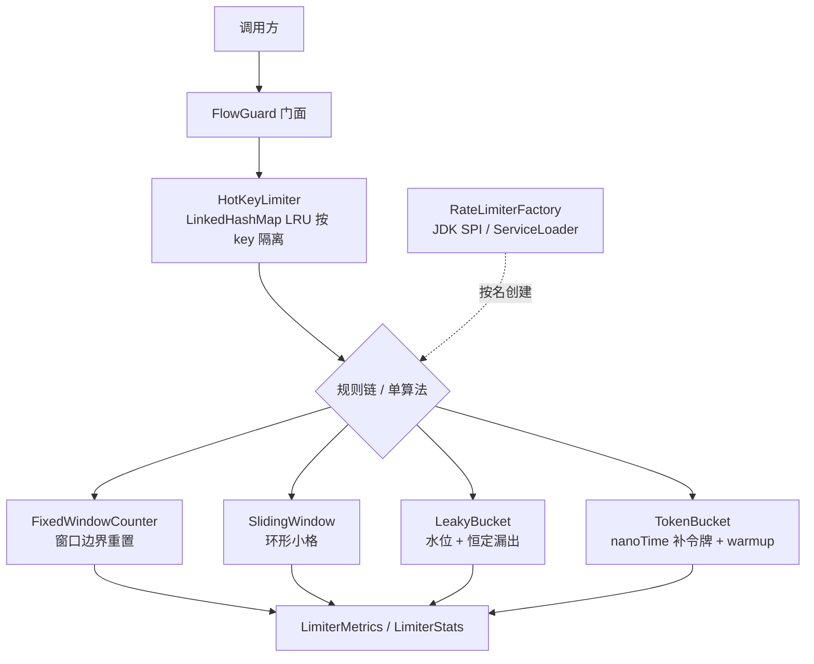

# flow-guard

纯 JDK 实现的限流内核：固定窗口 / 滑动窗口 / 漏桶 / 令牌桶四种算法，附热 key 隔离、规则链、AtomicLong 指标与 JDK SPI 发现，零运行时第三方依赖。

> 本模块已登记在仓库根 `pom.xml` 的 `<modules>` 中，以下命令均在仓库根目录执行。

## 模块结构

```
flow-guard/
├── pom.xml                         # parent = backend-portfolio:1.0.0，仅 test 依赖 junit-jupiter
├── README.md
└── src/
    ├── main/
    │   ├── java/dev/rainsolo/flowguard/
    │   │   ├── core/               # Clock / SystemClock / LimiterConfig(builder) / PermitResult / RateLimitExceededException
    │   │   ├── limiter/            # RateLimiter / AbstractRateLimiter / 四种算法 / HotKeyLimiter / RuleChain / AcquireSupport
    │   │   ├── metrics/            # LimiterMetrics(AtomicLong + Snapshot) / LimiterStats
    │   │   ├── spi/                # RateLimiterFactory + 4 个 Factory + Limiters 门面
    │   │   ├── demo/               # FlowGuardDemo / FlowGuardBenchmark
    │   │   └── FlowGuard.java      # 一行 builder 门面
    │   └── resources/META-INF/services/dev.rainsolo.flowguard.spi.RateLimiterFactory
    └── test/java/dev/rainsolo/flowguard/   # MutableClock + 5 个测试类
```

## 运行

```bash
mvn -B -pl flow-guard -am test
java -cp flow-guard/target/classes dev.rainsolo.flowguard.demo.FlowGuardDemo
java -cp flow-guard/target/classes dev.rainsolo.flowguard.demo.FlowGuardBenchmark
```

一行创建与组合规则：

```java
FlowGuard guard = FlowGuard.builder()
        .permitsPerSecond(5).burstCapacity(10)
        .algorithm("token").warmupMillis(2_000)
        .build();

if (guard.tryAcquire("user:42").allowed()) { /* pass */ }
double waited = guard.acquire("user:42", 1);   // 阻塞直到放行，返回等待秒数

FlowGuard composed = FlowGuard.builder()
        .permitsPerSecond(5).burstCapacity(10)
        .rule("sliding").rule("leaky")          // 多规则 AND 组合
        .perKey(false).build();
```

## 架构



## 四种算法对比

| 算法 | 精度 | 内存 | 是否允许突发 | 临界突刺 |
| --- | --- | --- | --- | --- |
| 固定窗口 `fixed` | 窗口级（粗，边界处全量重置） | O(1) | 否 | **有**：交界两侧短时可通过 2×permits |
| 滑动窗口 `sliding` | 小格级（`windowMillis / slidingSlots`） | O(slidingSlots) | 否 | 无，尾部窗口平滑滚动 |
| 漏桶 `leaky` | 连续（恒定漏出速率） | O(1) | 否，输出被整形为恒定 | 无 |
| 令牌桶 `token` | 连续（单调时钟补充） | O(1) | **是**，上限 `burstCapacity` | 无 |

## 关键实现取舍

- **滑动窗口用环形小格而不是记录每个请求时间戳**：逐请求时间戳能拿到理论最优精度，但内存是 O(QPS × 窗口)，高并发下要为每个请求存 long 并做范围清理，GC 与清理成本都随流量线性增长。环形小格把内存压到固定的 O(slidingSlots)，过期小格直接清零，代价是精度受 `slotMillis` 限制（默认 1000/10 = 100ms）——这是显式的「内存换精度」，`slidingSlots` 可调大来换更细粒度。
- **令牌桶用 `nanoTime` 而不是 `wallTimeMillis`**：墙钟会被 NTP 校准或人工调整，一旦回拨，`now - last` 为负可能饿死，一旦向前跳变会瞬间补出一大把令牌造成超发。实现里所有补充都基于单调 `nanoTime`，且**差值取非负**：`now <= last` 时只把基准重新对齐到 `now`、绝不铸造令牌，因此时钟回拨不产生额外令牌（有单元测试注入 `MutableClock.rewindMillis` 验证）。
- **warmup 的取舍**：冷启动阶段下游（连接池、缓存、DB）尚未预热，直接按满速率放流容易把依赖打挂。令牌桶让补充速率从 `permitsPerSecond / 3` 的冷值线性升到 `permitsPerSecond`。为保证曲线准确，补充量用**分段梯形积分**计算：线性段内取两端速率均值，跨越预热结束点时先切段再累加，而不是用某个瞬时速率乘整段时间。代价是每次 refill 多几次浮点运算，换来前期速率确实低于稳定期（有单元测试对比）。
- **基础限流器忽略 key，隔离交给装饰器**：四种算法本身是单实例共享配额的最小内核；按 key 隔离由 `HotKeyLimiter` 用 `LinkedHashMap(accessOrder=true)` + `maxTrackedKeys` 做 LRU 淘汰，避免 key 无限增长。「组合」则由 `RuleChain` 做 AND：任一规则拒绝即整体拒绝，并取所有拒绝里最大的 `waitMillis` 作为最严 retryAfter。已知取舍：被拒绝时已放行规则的配额不回滚，不做事务式补偿；`acquire` 采用 `Thread.sleep` 轮询 + `waitTimeoutMillis` 超时抛 `RateLimitExceededException`，不保证线程间排队公平性。
- **为何刻意不做成 Spring Boot Starter，而保持纯 JDK + SPI**：本模块定位是「可独立编译、可讲清算法」的限流内核，纯 JDK 让 `java -cp target/classes` 就能跑，零依赖冲突、零自动配置黑盒；算法扩展通过 JDK `ServiceLoader` 完成，`Limiters.create("token", ...)` 按名解析，SPI 缺失时回退内置实现。Starter 会带来条件装配、版本绑定、配置元数据等与限流算法无关的复杂度。真要接入 Spring，只需一个 `@Bean` 把纯 JDK 对象托管进去即可：

```java
@Configuration
public class FlowGuardConfig {
    @Bean
    public RateLimiter apiLimiter() {
        LimiterConfig config = LimiterConfig.builder()
                .permitsPerSecond(200).burstCapacity(400).warmupMillis(2_000).build();
        return new HotKeyLimiter(
                () -> Limiters.create("token", config, new SystemClock()), 10_000);
    }
}
```

## 压测

运行 `dev.rainsolo.flowguard.demo.FlowGuardBenchmark`：预热后 16 线程并发 `tryAcquire`，`Arrays.sort` 采样求 p99。

本机实测（JDK 17 / Windows，16 线程 × 10,000 次 = 160,000 次调用，预热 2,000 次）：

| 算法 | 吞吐 ops/s | p99 |
| --- | --- | --- |
| fixed | 6,453,825 | 96.20 us |
| sliding | 3,365,799 | 2.50 us |
| leaky | 5,705,218 | 96.80 us |
| token | 5,963,496 | 104.40 us |

> **读这组数字要注意**：四种实现都用 `synchronized` 换取并发下配额精确（16 线程通过数严格等于 permits），因此吞吐与 p99 主要反映抢锁 park/unpark、JIT、GC 与线程调度抖动，两次实测波动明显，**不能当作算法优劣的绝对判据**；未引入 JMH 正是为了守住零第三方依赖。滑动窗口 p99 更低是因为临界区更短、没有浮点 refill 计算。

## 设计要点与实测结果

- **能力**：实现固定窗口 / 滑动窗口 / 漏桶 / 令牌桶四种算法，提供按 key 独立配额的热点隔离（LRU 淘汰）与多规则 AND 组合，算法通过 JDK `ServiceLoader` 按名装配，运行时零第三方依赖。
- **取舍**：滑动窗口用环形小格把内存从 `O(QPS × 窗口)` 压到固定 `O(slots)`，代价是精度受 `windowMillis/slidingSlots` 约束（默认 100 ms）；令牌补充基于单调 `nanoTime` 且差值取非负，NTP 校时或时钟回拨不会凭空铸造令牌；冷启动 warmup 用分段梯形积分计算补充速率。保持纯 JDK + SPI 而非 Spring Boot Starter，接入只需一个 `@Bean`。
- **实测**：可变时钟单测复现固定窗口在交界处短时可通过 `2×permits` 的临界突刺，滑动窗口无此问题；16 线程并发通过数精确等于配额、无超发；160,000 次调用吞吐 336 万～645 万 ops/s，p99 2.5～104 us。

仓库总览见 [根 README](../README.md)。
