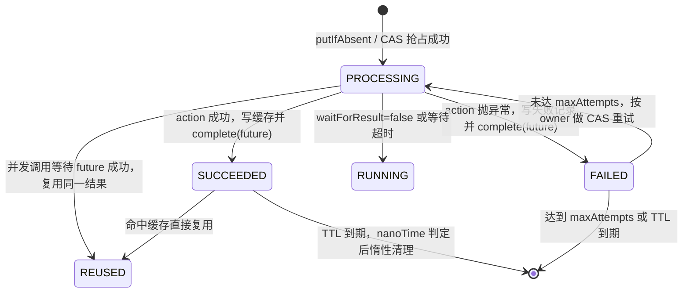

# idempotent-lock

纯 JDK 实现的幂等执行器与可重入分布式锁：CAS 抢占同 key 只执行一次、CompletableFuture 通知并发等待者复用结果；锁侧提供 lease、watchdog 续期、严格递增 fencing token 与 SPI 可替换存储。运行时零外部依赖，只用 `junit-jupiter` 做测试。

## 模块结构

```
idempotent-lock/
├── pom.xml                                  parent = dev.rainsolo:backend-portfolio:1.0.0
├── src/main/java/dev/rainsolo/idemlock/
│   ├── core/        Clock、SystemClock、Outcome、ExecutionResult、IdempotencyState、
│   │                IdempotencyRecord、IdempotentConfig（record + builder）
│   ├── store/       IdempotentStore、InMemoryIdempotentStore（ConcurrentHashMap + 惰性过期）
│   ├── executor/    IdempotentExecutor、IdempotentMetrics
│   ├── lock/        DistributedLock、LockStore、InMemoryLockStore、
│   │                ReentrantDistributedLock、FencingTokenGuard、LockManager、LockMetrics
│   └── demo/        IdempotentLockDemo、IdempotentLockBenchmark
├── src/main/resources/META-INF/services/    dev.rainsolo.idemlock.store.IdempotentStore（SPI）
└── src/test/java/dev/rainsolo/idemlock/    5 个测试类 + MutableClock
```

## 运行

```bash
# 在仓库根目录执行
mvn -B -pl idempotent-lock -am test
java -cp idempotent-lock/target/classes dev.rainsolo.idemlock.demo.IdempotentLockDemo
java -cp idempotent-lock/target/classes dev.rainsolo.idemlock.demo.IdempotentLockBenchmark
```

```java
IdempotentExecutor executor = new IdempotentExecutor(IdempotentConfig.builder()
        .ttlMillis(60_000).waitForResult(true).waitTimeoutMillis(5_000).maxAttempts(3).build());
ExecutionResult<String> result = executor.execute("pay:order-1", () -> charge("order-1"));

LockManager locks = LockManager.builder().defaultLeaseMillis(30_000).watchdog(true).build();
DistributedLock lock = locks.lock("account-1");
if (lock.tryLock(30_000, 1_000)) {
    try {
        write(lock.fencingToken());   // 下游用 FencingTokenGuard.accept(token) 挡住陈旧写入
    } finally {
        lock.unlock();
    }
}
```

## 幂等状态机



`store.replace(key, expectedOwner, record)` 只有当记录仍属于抢占者时才允许迁移状态，避免慢执行者覆盖已被 TTL 回收后重新抢占的 key。PROCESSING 占位租约取 `ttlMillis + waitTimeoutMillis`，比结果缓存更长寿，防止「action 还没跑完就因 TTL 被第二个线程再执行一次」。

## 锁生命周期

1. `tryLock(leaseMillis)` 调 `LockStore.acquire`，用 `ConcurrentHashMap.compute` 原子判定「无主或 lease 已过期」，成功时由该 name 独立的 `AtomicLong` 发出严格递增的 fencing token。
2. 持有期间 watchdog 守护线程每 `lease / 3` 调 `renew` 延长 lease；`unlock` 先停 watchdog 再 `release`，最后一个重入层次才真正释放。
3. 不续期时 lease 到点即视为无主（`nanoTime >= expireAtNanos`），其它线程可抢占并拿到更大的 token；原持有者的写被 `FencingTokenGuard` 拒绝。
4. 所有 lease 判断只用 `Clock.nanoTime()`，wall clock 回拨、NTP 校时都不会让锁提前过期或永久卡死。
5. `isHeldByCurrentThread` 同时校验创建线程、本地 `holdCount`、本地 deadline 与 `store.holder(name)`，锁被抢走后立即返回 `false`，`fencingToken()` 返回 `-1`。

## 关键取舍

**CAS 抢占 vs Redis SETNX + Lua**：本模块用 `ConcurrentHashMap.compute` 把「读旧值 → 判定过期 → 写入」收进一次原子操作，等价于 SETNX + Lua 的 check-and-set，单 JVM 内不需要网络往返、没有 Lua 脚本版本管理，也便于用 `ServiceLoader` 直接换成 Redis 实现；代价是不跨进程，跨进程必须换 `IdempotentStore` / `LockStore` 实现，接口已按「原子抢占」「按 owner 比较并替换」的语义设计，映射到一个 Lua 脚本即可。

**fencing token 防 GC 停顿脏写**：锁过期本身不足以保护共享资源。线程 1 在 lease 内停顿（GC、STW、网络阻塞），线程 2 在过期后拿到锁并写入，线程 1 醒来继续写就会造成脏写。`InMemoryLockStore` 为每个 name 维护独立 `AtomicLong`，每次成功抢占都发一个更大的 token，下游 `FencingTokenGuard.accept(token)` 只接受严格大于 `lastAccepted` 的 token，旧 token 返回 `false` 并累计 `rejectedCount`。demo 场景 B 复现了这个过程。

**watchdog 间隔为什么取 lease / 3**：一次续期失败后还有约 `2/3 lease` 的缓冲用于重试和线程调度，即使遇到一次 park 抖动或短暂 CPU 饥饿也不会立刻丢锁；取 `lease/2` 缓冲太薄，取 `lease/10` 又会显著增加续期频率。间隔设了 1ms 下限，避免极小 lease 把续期线程变成忙循环。

### 为什么不实现 Redlock

Redlock 要求向 N 个独立节点依次加锁，用「超过半数成功 + 总耗时小于 lease」判定成功，其安全性依赖几个很强的假设：各节点时钟漂移可忽略、网络延迟有界、进程没有长停顿。GC 停顿恰好能同时打破后两条——客户端在计时窗口内停顿，回来时票已经「过期」，而它仍认为自己持有锁；多节点只是把时钟假设从一台机器放大到 N 台，并没有消除它。更根本的是，Redlock 仍不带 fencing token，过期后旧持有者的写无法被下游识别。因此本模块选择单存储 + 严格递增 token：把「互斥」交给原子抢占，把「过期后旧写的隔离」交给 fencing token；需要多副本高可用时，应在存储层用共识协议（而非客户端多数派投票）并提供全局单调 token，那已经超出纯 JDK 模块的边界。

**为什么不提供 Spring Boot Starter**：Starter 会带来自动配置、条件装配、属性绑定和版本兼容矩阵，把「纯 JDK + 零依赖」这个最容易被验证的特性淹没；而且幂等 key 的序列化、锁名规范、存储客户端都强依赖业务，自动配置往往猜错。这里保持纯 JDK 并用 `META-INF/services` 暴露 SPI，接入 Spring 只需显式声明几个 Bean：

```java
@Configuration
class IdemLockConfig {
  @Bean IdempotentStore store() { return ServiceLoader.load(IdempotentStore.class).findFirst().orElseThrow(); }
  @Bean IdempotentExecutor executor(IdempotentStore s) {
    return new IdempotentExecutor(s, new SystemClock(), IdempotentConfig.defaults());
  }
  @Bean LockManager locks(LockStore s) {
    return LockManager.builder().store(s).defaultLeaseMillis(30_000).watchdog(true).build();
  }
}
```

## 压测

`IdempotentLockBenchmark` 预热后以 16 线程采样幂等 execute 与锁 acquire/release 的 `nanoTime` 耗时，用 `Arrays.sort` 取 p99。

本机实测（JDK 17 / Windows，16 线程 × 20,000 次 = 320,000 次操作）：

| 场景 | 吞吐 | p99 |
| --- | --- | --- |
| 幂等 `execute`（同 key 结果复用） | 1,889,164 ops/s | 10.8 us |
| 锁 `acquire` / `release` | 3,231,448 ops/s | 8.3 us |

> 这是 `InMemoryStore` 的**单 JVM 进程内**数据；跨进程换成 Redis 实现后数量级完全不同，不要把该数字当作分布式锁的性能结论。

## 设计要点与实测结果

- **能力**：幂等执行器用 CAS 抢占保证并发同 key 的 action 只执行一次，`CompletableFuture` 让并发调用复用同一结果；锁侧实现可重入、lease、watchdog 续期、超时自动释放与严格递增 fencing token，存储层通过 SPI 可替换为 Redis `SETNX` + Lua。
- **取舍**：幂等状态机 `PROCESSING → SUCCEEDED / FAILED`，占位租约取 `ttl + waitTimeout` 防止慢执行者未完成就被第二个线程重新执行；`store.replace(key, expectedOwner, ...)` 避免 TTL 回收后的旧持有者覆盖新记录。锁刻意不实现 Redlock——多节点多数派仍依赖时钟漂移可忽略、网络延迟有界、进程无长停顿等假设，且不带 fencing token，无法识别过期后的旧写；改为单存储原子抢占 + 下游 `FencingTokenGuard` 校验严格递增 token。所有 lease 判定只用 `nanoTime`，墙钟回拨不影响；watchdog 间隔取 `lease/3`，一次续期失败后仍有约 2/3 lease 缓冲。
- **实测**：32 线程并发同 key 的 action 执行次数为 1；demo 复现 GC 停顿场景（`T1 token=1` 停顿 → `T2 token=2` 写入成功 → `REJECTED stale token=1`）；16 线程压测幂等 189 万 ops/s（p99 10.8 us）、锁 acquire/release 323 万 ops/s（p99 8.3 us）。数据为单 JVM 内存实现，跨进程换 Redis 后数量级不同。

仓库总览见 [根 README](../README.md)。
